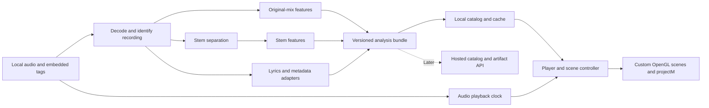

# Harmonic: objectives, implementation direction, and roadmap

Prepared October 22, 2026, from `OUTLINE.md`. Technology and provider observations below were checked against primary documentation where available. Recommendations, proposed specifications, and effort ranges are engineering judgments, not benchmark results or vendor quotes.

Implementation update: the original-mix prototype is available; build and usage instructions are in [README.md](README.md). It analyzes local audio into JSON/Arrow bundles and displays spectrum bars, an amplitude envelope, and onset activity in a C++/SDL3/OpenGL player. The supplied “Billie Jean” recording passes native decoding/checksum validation and dummy-audio pause/seek/end-of-track checks; offscreen rendering previews have been inspected. Fifty checks cover signal analysis, CLI behavior, native playback, projectM rendering/compositing, local catalog/reuse, SAM job/worker contracts, command-status handling, and optional global task-viewer integrations. Optional projectM presets now play with graph overlays, a preset view, cached pause behavior, and sample-based seek resets. A local SQLite catalog tracks exact-file identities, locations, and verified reusable mix bundles. SAM Audio access is now granted; the isolated worker is prepared, while installation, authentication, and inference on a GPU host remain pending. The owner has confirmed Billie Jean listening on the actual audio output and visible desktop controls/end-of-track behavior. Quantitative physical-output latency, target-GPU frame times, and contrasting recordings remain validation work.

## 1. Assessment of your objectives

You are building a music visualization system with advance knowledge of the song: separated instrument activity, spectral changes, lyrics, song structure, and emotional context. That advance knowledge is the most useful distinction from a visualizer that reacts only to the current audio buffer. It enables anticipation, section transitions, and a consistent visual identity for each recording.

The outline contains two products that can share a foundation:

1. **An analysis pipeline and catalog:** turn recordings into reusable, time-aligned musical data, preserve its provenance, and eventually serve it to clients.
2. **A desktop player and rendering engine:** synchronize that data with audio playback and turn it into increasingly sophisticated scenes.

My recommendation is to prove the desktop experience with local analysis files first, while designing those files so a server can deliver them later. The initial success criterion should be that distinct instruments visibly drive distinct elements, remain synchronized after seeking, and produce a more intentional experience than full-track amplitude alone.

Several distinctions will keep implementation aligned with what you actually want:

- **Instrument stems differ from stereo channels.** Vocals, drums, bass, and remaining accompaniment are estimated sources extracted from a finished mix. They are not guaranteed reconstructions of the original studio tracks.
- **“Frequency and amplitude modulation” needs a concrete specification.** For visualization, you primarily want time-varying spectral energy, loudness envelopes, and musical events. Pitch trajectories are a separate feature; a drum kit or polyphonic accompaniment does not have one meaningful instantaneous pitch.
- **Track mood and momentary activity serve different purposes.** Mood and genre can select palettes, environments, and scene families. Stem energy, onsets, and beats should animate them. A chorus can be loud while the song remains sad.
- **The audio is temporary input to analysis, but still necessary for playback.** You can discard separated stem audio after extracting features. The player still needs the original recording, and new analyses may require separating it again.

Assumptions for this plan: prerecorded local MP3s first; preprocessing is acceptable; desktop OpenGL and projectM reuse are priorities. Target operating systems, available GPU hardware, distribution license, and commercial ambitions remain unspecified.

## 2. Recommended technology direction

**Use Python for offline analysis, C++20 with SDL3 and OpenGL for the player, SQLite for the local catalog, and versioned binary feature artifacts. Add a Python API with PostgreSQL and object storage when the shared service becomes useful.**

| Layer | Recommended starting choice | Reason and tradeoff |
| --- | --- | --- |
| Audio analysis | Python, NumPy, SciPy, librosa; FFmpeg for decoding | Gives direct access to audio research tools and measurable DSP. Keep this outside the rendering process. |
| Source separation | SAM Audio large TV through the isolated GPU worker; Demucs as an optional comparison/fallback | Access granted; dependency graph locked. Validate GPU runtime, prompt behavior, timing, gain, and resource use before depending on it. |
| Native client | C++20, CMake, SDL3 | Direct integration with native audio, OpenGL, and libprojectM. Costs more packaging and memory-management work than a Python prototype. |
| Graphics | OpenGL 3.3 core as an initial target, GLSL, GLAD, GLM | Fits the requested direction. Confirm the selected projectM release and target GPUs during the initial integration spike. |
| Playback | FFmpeg libraries for decode/resampling, SDL3 audio for output | Using the same decoding rules in analysis and playback reduces timing ambiguity. Account for device buffering separately. |
| Initial controls | Dear ImGui | Useful for feature inspection, shader tuning, and debugging. Revisit the application UI when the experience stabilizes. |
| Local catalog | SQLite | Appropriate for a desktop application and a single-machine analysis queue. |
| Feature exchange | JSON manifest plus Arrow IPC files containing typed arrays | Explicit cross-language schema; avoid making the client understand Python objects. Load a whole track initially; introduce chunks if scale requires them. |
| Future catalog service | FastAPI, PostgreSQL, S3-compatible object storage, separate workers | Keeps analysis code reusable and separates searchable metadata from large artifacts. |

The library choices are grounded in [librosa’s feature APIs](https://librosa.org/doc/0.10.2/feature.html), [SDL3’s native audio and graphics support](https://wiki.libsdl.org/SDL3/FrontPage), [SQLite’s intended use cases](https://www.sqlite.org/whentouse.html), [Arrow’s C++ IPC support](https://arrow.apache.org/docs/cpp/ipc.html), and [FastAPI’s documentation](https://fastapi.tiangolo.com/).

C++ is the strongest default here because libprojectM is already a native OpenGL visualization library. Reusing it avoids recreating its preset parser and rendering behavior. This recommendation follows your OpenGL/projectM priorities; it is not a claim that every new graphics application should use OpenGL. [projectM repository](https://github.com/projectM-visualizer/projectm)

If you strongly prefer Rust, keep the Python analysis layer and consider a Rust client using OpenGL bindings and libprojectM’s C interface. That is viable, but adds binding and integration work. If macOS is a primary long-term target, reconsider the graphics choice before building many shaders: Apple marks OpenGL deprecated. A Metal/WebGPU-oriented renderer would change the projectM integration strategy. [Apple OpenGL documentation](https://developer.apple.com/documentation/appkit/nsopenglprofileversion4_1core?language=objc)

Start with a command-line analyzer and a separate player. They can communicate through completed artifacts and catalog records; an embedded Python runtime, always-running local server, or distributed task system is unnecessary for the first version.

## 3. Audio analysis: the data worth keeping

### Separation and the role of AI

Begin with four stems: **vocals, drums, bass, other**, plus independently measured features for the original mix. A four-stem baseline makes the scene model manageable. Additional instruments can follow when they produce a clear visual benefit.

**SAM Audio is the preferred separation direction, replacing the earlier Demucs-first recommendation. The owner confirmed access to `facebook/sam-audio-large-tv`.** Its text, visual, and temporal prompting support fits the goal of eventually extracting more specific sources than four fixed instrument groups. Actual separation quality for this library remains to be measured. [SAM Audio repository](https://github.com/facebookresearch/sam-audio)

Demucs remains an optional comparison or fallback, not the default implementation target. Its original repository states it is no longer maintained and points to the author’s fork; freeze any selected code and checkpoint behind the same adapter. [Demucs README](https://github.com/facebookresearch/demucs/blob/main/README.md?plain=1)

Use specialized separation models or a music-analysis API for the signal processing. OpenAI or Claude could help map existing descriptors into a controlled vocabulary, interpret verified lyric themes, or propose scene settings. Their generated descriptions should not become measured frequency curves, stem envelopes, or beat timestamps. OpenAI’s documented file-transcription workflow targets speech-to-text; it does not establish suitability for instrument separation or precise singing alignment. [Official OpenAI transcription documentation](https://developers.openai.com/api/docs/guides/speech-to-text)

### SAM Audio integration direction (GPU validation pending)

The documented API isolates a prompted target and returns a residual, each as a one-dimensional waveform. It does not expose the same fixed four-stem interface as Demucs. This implies that separate instrument prompts need evaluation for overlap and omissions; their outputs must not automatically be treated as an exclusive partition of the mix. [Model card and output format](https://huggingface.co/facebook/sam-audio-base)

Proposed integration steps:

1. Benchmark the prepared short “Billie Jean” excerpt with the selected large-TV checkpoint and prompts for vocals, drums, and bass on a GPU host. Compare quality, elapsed time, and memory; consider a smaller checkpoint if capacity requires it and access permits. CUDA is recommended upstream; no GPU memory minimum has been validated here. [Setup and model variants](https://github.com/facebookresearch/sam-audio)
2. Record checkpoint revision, prompt, temporal anchors, native sample rate/channel layout, gain handling, and inference settings in the analysis provenance. Preserve mono output as mono in provenance; duplicating it for feature extraction does not establish stereo width.
3. Map output back to the original 48 kHz sample timeline and verify alignment, sample counts, and relative level. Establish a chunk/overlap policy for full songs and test boundary artifacts before catalog processing.
4. Keep the worker in a separate inference environment. Its upstream dependencies include PyTorch, TorchAudio, TorchCodec, and Git-sourced packages; avoid coupling them to the lightweight analyzer/player environment. [Dependency manifest](https://github.com/facebookresearch/sam-audio/blob/main/pyproject.toml)
5. Confirm the SAM License fits the eventual distribution/service design. It is a separate license from Demucs; checkpoint access does not make them interchangeable licenses. [SAM License](https://github.com/facebookresearch/sam-audio/blob/main/LICENSE)

The v0.7.0 worker is prepared in [workers/sam_audio](workers/sam_audio/README.md).
Its isolated Python 3.11/CUDA 12.8 dependency graph resolves with 213 packages,
including pinned upstream Git revisions. The main analyzer environment remains
separate. Jobs carry an at-most-30-second canonical stereo excerpt, exact source
and PCM identity, sample offset, prompts, seed, and settings. A real 10-second
Billie Jean job at 30 seconds is prepared at `data/sam-jobs/billie-jean-v0.7.0/`.
The worker can produce independent mono target/residual WAV pairs with hashes,
timing/memory reports, and return-file validation; actual inference is unverified.

The selected checkpoint revision is `b9fc94687ec044c570cbe30b8c28100cd056f1cb`,
with a 14,861,356,211-byte checkpoint file before auxiliary models or runtime
memory. The main model and source are pinned; auxiliary text-model resolution is
recorded by commit, with an explicit revision option for subsequent repeat runs.
This baseline uses float32, one candidate, no anchors/span prediction/ranking,
and the upstream midpoint solver step of 0.0625. Canonical stereo is averaged to
mono without gain normalization; outputs retain their initial sample position,
with only bounded trailing codec padding trimmed. This does not establish
perceptual alignment or source quality.

The local machine exposes Intel Iris Xe graphics and 16 GB RAM; no CUDA device
works even outside the sandbox, and no Hugging Face token is configured. The
owner chose to prepare here and run later on a GPU host. No inference stack or
checkpoint weights were installed locally; no real inference benchmark has run.
Dependency resolution and CPU contract tests do not establish runtime/GPU
compatibility. The SAM License was inspected; Perception Models and ImageBind
declare noncommercial licenses, so distribution/service review remains open.
The current mix player remains usable. Track the work in [TODO.md](TODO.md).

### Proposed first feature contract

| Feature | Scope and initial resolution | Visual use |
| --- | --- | --- |
| RMS and peak envelope | Each stem and original mix; about 50 samples/second | Size, opacity, displacement, intensity |
| Spectral energy | Each stem and mix; initially 64 logarithmic or mel bands at about 50 frames/second | Bars, radial shapes, ribbons, shader textures |
| Onset strength and event timestamps | Per stem where useful, especially drums | Percussive impulses and particle emission |
| Beat timestamps and beat confidence | Primarily the mix; retain variable timing | Pulses and rhythm-aware transitions |
| Summary statistics | Per feature and stem | Stable normalization and relative comparisons |
| Optional pitch/chroma | Bass/vocals for pitch; mix for harmonic context | Vertical position, melodic traces, color relationships |
| Section boundaries and slow energy trends | Track-level timeline | Scene changes, builds, breakdowns |
| Stereo width or balance | Optional later feature | Spatial movement and separation |

RMS and mel-spectral measurements are directly supported by librosa. Treat the table’s rates and band counts as starting specifications to validate visually. Longer spectral windows improve frequency detail but smear transients, so bass and percussion may eventually need different analysis windows on a common timeline. [RMS documentation](https://librosa.org/doc/0.11.0/generated/librosa.feature.rms.html), [mel-spectrogram documentation](https://librosa.org/doc/main/api/generated/librosa.feature.melspectrogram.html)

Keep measured values and display normalization separate. Store units, band edges, scale, window size, hop size, sample rate, and frame-center offset. Preserve min/max values, but use robust percentiles and a silence floor for most display mappings; a single outlier should not make the rest of a song appear flat. Include both absolute measurements and per-track relative activity.

**Preserve relative stem gain.** Demucs documents that its output handling can independently rescale stems to prevent clipping. That can distort comparisons of vocal, bass, and drum strength. Prefer floating-point inference output before export normalization, or a recorded common gain; inspect commercial providers for similar normalization. Do not solve the problem by simply accepting clipped stems. [Demucs output behavior](https://github.com/facebookresearch/demucs)

Magnitude spectra and envelopes deliberately discard information. They will not reconstruct arbitrary stem waveforms or support every future analysis. Keep the original-file reference and a reproducible analysis recipe so reprocessing remains possible.

## 4. Timing, identity, and storage architecture

### A single musical timeline

Define all timings relative to the decoded original recording. Record integer sample positions where possible and explicit transformations when a model resamples audio. Preserve stereo at ingestion; define how spectral power is combined instead of accidentally cancelling out-of-phase channels through a naive mono conversion.

The client should derive visual time from playback progress, with device-latency compensation. A render-loop stopwatch or the amount of audio queued for output is insufficient by itself. Handle MP3 encoder delay/padding, resampling, pause, seek, output-device changes, and a user-adjustable synchronization offset. Test drift over a full track as well as immediately after seeking.

Each renderer samples the feature timeline at the current audio time and interpolates continuous values. Discrete events need crossing detection so a frame-rate hitch does not silently skip a beat trigger.

### Recording identity matters more than song identity

Store separate identities for the musical work, a particular recording/version, a local file, and an analysis revision. A live version, radio edit, remaster, and album version can share names while requiring different timing data.

Use an exact file hash to recognize unchanged imports; a tag edit changes that hash, so optionally add a hash of consistently decoded audio. Fingerprints, MusicBrainz IDs, ISRCs, names, and duration can help find candidates, but must not automatically authorize reusing a timeline. Match the actual recording and offset before attaching existing timed analysis.

### Database responsibilities

Proposed logical entities:

- `recordings` and `audio_files`: identity, duration, local references, fingerprints, external IDs.
- `analysis_runs`: pipeline version, checkpoint/model version, parameters, input identity, status, runtime, and cost.
- `feature_artifacts`: schema version, URI/path, checksum, stem names, array shapes, and timebase.
- `metadata_observations`: provider, taxonomy/model version, original payload, scores, timestamps, and permitted uses.
- `lyric_tracks`: language, source, recording match, timing granularity, timing offset, and usage constraints.
- `overrides`: user corrections with priority over inferred defaults, without destroying source observations.

Keep searchable metadata and artifact references in SQLite, then PostgreSQL for the hosted catalog. Keep dense arrays in files/object storage. Making every time-frequency cell a database row would create unnecessary query and indexing overhead.

As an illustrative size calculation, five streams × 64 bands × 50 frames/second × 240 seconds × four-byte floats is **15.36 MB per four-minute track**, before other features and compression. At 10,000 tracks that is **153.6 GB** for this spectrum representation alone. Validate acceptable band count and precision early; compression savings depend on the data. Start with float32 and consider lower precision after visual comparison.

Publish artifacts atomically, checksum them, and make completed revisions immutable. Record stage-level success so a failed lyric provider does not force another expensive separation run. Cache by input identity plus model, parameters, and schema version.

The implemented local catalog in v0.6.0 covers the current original-mix stage:
`harmonic-catalog import` creates or reuses analysis, `import --bundle` registers
an existing bundle, and `list` displays saved identities/references. Both commands
offer JSON output; help/version aliases follow the other CLIs. SQLite contains
`recordings`, `locations`, and `analyses`; dense arrays stay in immutable Arrow
bundles. The catalog has its own application identifier and schema version and
rejects unrelated or unsupported databases.

Deduplication is conservative: byte-identical files share an identity, while
different source bytes remain distinct even when decoded PCM matches. A moved
file can reuse its bundle; playback uses the existing `--audio` override. Cache
hits recheck source bytes, saved manifest/artifact hashes, fixed v1 parameters,
and Arrow content/timebase. External bundles additionally require current-decoder
PCM equality before registration. The fixed pipeline is the current cache key;
SAM Audio/model stages must add checkpoint, prompt, and parameter identities.
Corrupt cached artifacts fail explicitly. A complete managed bundle surviving a
registration interruption is validated and adopted on retry. This is single-track
mix reuse, not a bulk queue or full stage-retry implementation.

## 5. Assessment of the services already listed

The list mixes machine-readable analysis APIs, catalog lyric suppliers, scraping libraries, and interactive discovery tools. They should have different roles in the system.

| Service or tool | Recommended role |
| --- | --- |
| Cyanite | First tagging API I would evaluate for this use case. Its current documentation exposes versioned outputs and both track-level and segment-level data. Retrieve actual segment timestamps; do not assume a tag stream updates at rendering speed. [Model outputs](https://docs.cyanite.ai/docs/guides/model-outputs/) |
| Bridge.audio | Credible alternate tagging candidate. Its API describes upload, status, tags, and webhook delivery. Compare actual outputs against your library before integrating a second tagger. [API overview](https://www.bridge.audio/features/api/) |
| SONOTELLER | Candidate for descriptive music and lyric metadata. Its site describes dedicated music, lyric-analysis, and section-tagging endpoints. Treat descriptions separately from measured DSP. [Product/API overview](https://sonoteller.ai/) |
| Musiio | Candidate for catalog tagging and, later, search. There is documented Tag API access rather than only a consumer interface. Confirm current account access and commercial terms. [Tag API](https://docs.musiio.com/tag/) |
| AIMS API | Potential fit for a larger catalog/search product. Establish which desired fields it predicts from audio versus which fields your catalog must supply; its documentation includes both metadata and catalog operations. [API documentation](https://docs.aimsapi.com/) |
| Musixmatch Pro | Keep as a commercial lyric-catalog candidate. Its official SDK documents lyric and subtitle resources, but current developer onboarding, pricing, and relevant rights were not verified here because its developer sites could not be fetched. Obtain a current proposal before depending on it. [Official SDK schema](https://github.com/musixmatch/musixmatch-sdk/blob/master/swagger/swagger.json) |
| LyricsGenius | Useful for experiments, but the package scrapes lyric pages. An installed library or API token does not establish a stable licensed lyric feed. Avoid making it the foundation of the hosted catalog. [How it works](https://lyricsgenius.readthedocs.io/en/latest/how_it_works.html) |
| LRCLIB / LRCGET | Good discovery/import path for existing synchronized lyrics. Integrate the LRCLIB API rather than automating the LRCGET application. Current docs include line synchronization and a word-timed Lyricsfile representation; coverage and timing quality must be checked per track. API accessibility does not settle lyric redistribution rights. [API documentation](https://lrclib.net/docs) |
| Every Noise at Once | Useful reference for genre vocabulary and discovery. Treat it as a reference resource until a supported integration and appropriate reuse permission are established. [Author-hosted site](https://www.furia.com/everynoise_public/) |
| Chosic | Useful for manual genre exploration. Its genre taxonomy page describes Spotify-derived data; this is not equivalent to a contracted audio-analysis feed. [Genre data description](https://www.chosic.com/list-of-music-genres/) |
| PitchPlus | Useful as a manual comparison for song descriptors. Its product is oriented toward artist promotion; a supported bulk analysis API and suitable reuse rights were not established in this review. [Product description](https://pitchplus.app/what-is-pitchplus) |
| SubmitHub “What's My Genre?” | Useful as a manual genre comparison. It has its own evolving detector, but the inspected material did not establish a supported third-party analysis API. [Detector description](https://www.submithub.com/story/upgrading-whats-my-genre) |

Start with one tagging provider. Store its original scored labels and create your own small mapping to scene controls. Scores from different taxonomies are not automatically comparable probabilities, and disagreements should remain inspectable rather than being averaged away.

Import the valence/danceability and other tags already present in your MP3s, preserving their source where known. Do not assume you can replenish them from Spotify: its November 2024 changes restricted Audio Features and Audio Analysis for new use cases, and its February 2026 update further narrowed Development Mode. Self-computed descriptors should have their own names and provenance rather than claim Spotify-equivalent semantics. [2024 API changes](https://developer.spotify.com/blog/2024-11-27-changes-to-the-web-api), [2026 developer-access update](https://developer.spotify.com/blog/2026-02-06-update-on-developer-access-and-platform-security)

The local-file design also avoids making Spotify playback a dependency. Any later Spotify integration needs its own assessment: the developer policy restricts visual synchronization and analysis of Spotify content. Those restrictions should not be generalized to every unrelated local recording. [Spotify Developer Policy](https://developer.spotify.com/policy)

## 6. Additional services and tools worth knowing

| Addition | Why it belongs on your shortlist |
| --- | --- |
| **Music.ai / Moises developer platform** | Especially relevant: stem separation, beat and section transcription, lyric transcription, and alignment modules. Could reduce the number of vendors needed for an initial paid pipeline. Compare the actual workflow cost and output contract. [Module pricing/catalog](https://music.ai/pricing/), [lyric alignment](https://music.ai/modules/utilities/lyrics-and-speech-alignment/) |
| **AudioShake** | Strong candidate for a paid comparison covering both instrument separation and singing-specific lyric transcription/alignment. Its FAQ explicitly distinguishes lyric transcription from speech transcription. [Capabilities and API](https://audioshake.ai/faq) |
| **Chromaprint / AcoustID and MusicBrainz** | Recording identification and canonical metadata are missing from the outline and become essential for a reusable catalog. AcoustID can connect fingerprints to MusicBrainz metadata. The free AcoustID service is for noncommercial use; commercial arrangements exist. MusicBrainz’s public API also has usage conditions and rate limits. [AcoustID service](https://acoustid.org/webservice), [commercial availability](https://acoustid.org/), [MusicBrainz API](https://musicbrainz.org/doc/MusicBrainz_API) |
| **ACRCloud** | Alternate identity/metadata supplier if commercial catalog coverage becomes important. Its metadata API accepts identifiers such as ISRC and returns cross-platform metadata; this does not substitute for checking exact recording alignment. [Metadata API](https://docs.acrcloud.com/reference/metadata-api) |
| **Essentia** | Valuable music-analysis research toolkit and pretrained classifiers. Its library and model licensing differ: AGPLv3 for the library, and the official pretrained models are listed under CC BY-NC-ND 4.0 with proprietary licensing available. Evaluate the exact intended usage before making it part of a commercial service. [Licensing](https://essentia.upf.edu/licensing_information.html) |

For the separation experiment, prioritize **SAM Audio on the prepared GPU worker**, with Demucs or either Music.ai/AudioShake as an optional comparison. Evaluate **Cyanite as the single semantic tagger** afterward. No separation or provider-quality benchmark has been run; the supplied recording has so far been processed only for original-mix features and a portable excerpt job.

## 7. Lyrics need their own pipeline

Lyric acquisition, transcription, alignment, and display are separate tasks. Existing synchronized text may avoid both transcription cost and transcription errors. Begin with line-level display from embedded/imported LRC or a suitable provider, matched to the exact recording.

When timing is missing, align verified lyrics to the recording, preferably using a singing-specific tool. Music.ai documents alignment of supplied subtitle text to singing, and AudioShake offers lyric-specific transcription/alignment. A generic speech transcript should be treated as a candidate requiring review. [Music.ai alignment](https://music.ai/modules/utilities/lyrics-and-speech-alignment/), [AudioShake FAQ](https://audioshake.ai/faq)

Handle instrumental tracks, repeated choruses, long vocal pauses, multiple languages, backing vocals, explicit versions, and missing lyrics. Provide a simple manual offset correction. Add word highlighting only after line timing works well; a lyric editor can be more useful than another automatic provider.

Store lyric-derived themes separately from audio-derived mood. Their disagreement can be meaningful, and lyric text may carry different display, caching, and redistribution conditions from timing or analysis fields.

## 8. Turning the data into good visuals

Introduce a small **scene controller** between analysis data and rendering. It should turn observations into stable visual controls rather than letting every shader invent its own audio interpretation.

| Musical input | First mapping to try |
| --- | --- |
| Drum onset and beat phase | Short impulses, radial expansion, particle bursts |
| Bass envelope and spectrum | Large-scale motion, displacement, low-frequency geometry |
| Vocal activity and pitch confidence | Foreground ribbons, lyric emphasis, vertical motion |
| Other-stem spectrum | Secondary geometry and texture detail |
| Mood and genre | Palette, background artwork, lighting, scene family |
| Sections and slow energy changes | Camera movement, density, transitions |

These are artistic hypotheses to compare, not universal genre-to-color rules. Use attack/release smoothing, thresholds, and hysteresis so weak or noisy signals do not make the scene flicker. Permit user overrides and restrained intensity settings. Begin with curated backgrounds or procedural palettes; image generation does not need to be a runtime dependency.

For the proposed 3D visualization, start with a fixed spatial home for each stem, frequency bands along one axis, and amplitude controlling height or radius. This creates a legible spatial arrangement without requiring actual acoustic source localization. Add motion only when it improves interpretation.

### Reusing projectM and MilkDrop

Use libprojectM as an optional rendering component and composite its output with custom graphics and lyrics. Its API accepts PCM audio, and newer rendering APIs expose user-provided framebuffers. Verify the exact release API during the initial spike. [Audio API](https://github.com/projectM-visualizer/projectm/blob/master/src/api/include/projectM-4/audio.h), [OpenGL rendering API](https://github.com/projectM-visualizer/projectm/blob/master/src/api/include/projectM-4/render_opengl.h)

Legacy presets do not automatically understand your stem spectra, mood scores, or lyric events. Feed original-mix PCM to the compatibility renderer; route cached analysis into your own scenes and compositor. Exposing additional variables inside legacy presets is a separate extension project. Magnitude-only artifacts cannot replace the PCM expected by arbitrary existing presets.

Do an early test with representative presets rather than assuming full visual compatibility: MilkDrop shaders use HLSL and projectM translates them for its OpenGL renderer. Preset state and feedback also need a policy for seeking: reset and transition cleanly first, rather than promising identical reconstructed frames. [Compatibility notes](https://github.com/projectM-visualizer/projectm/wiki/Milkdrop-Compatibility)

### Verified projectM integration spike — October 22, 2026

The optional `harmonic-projectm-check` tool validates an existing analysis bundle
and its native decoded PCM, feeds the original stereo mix to libprojectM, renders
offscreen, and writes a PPM preview plus a JSON report. The normal player also
builds with projectM discovery disabled. This establishes a working integration
path while keeping the diagnostic player independent of the optional library.
Usage and color/progress controls are documented in [README.md](README.md).

Two local presets from the upstream [Cream of the Crop pack](https://github.com/projectM-visualizer/presets-cream-of-the-crop)
were checked at checkout `0180df21f5e0bd39b9060cc5de420ed2f1f9e509`:

| Preset | Style | Render p50 | Render p95 | Local report |
| --- | --- | --- | --- | --- |
| `Geometric/Wire Circles/Geiss - Many Colors 1.milk` | Classic waveform/feedback | 121.82 ms | 188.50 ms | `data/projectm-v0.4.0-geiss/report.json` |
| `Waveform/Spectrum/Jc - Flow with the Go.milk` | HLSL warp/composite shaders | 245.14 ms | 390.50 ms | `data/projectm-v0.4.0-flow/report.json` |

Both v0.4.0 runs used “Billie Jean” starting at 30 seconds, 180 frames on a 60 Hz
explicit timeline, a 64×48 mesh, and a 1920×1080 output. The first 30 frames were
excluded from timing statistics. Each fed 143,200 stereo PCM frames, ending at
32.983333 seconds. The reported libprojectM runtime is 4.1.0, revision
`36490443622c7cd671e41e512568a845add3a392`. The renderer is Mesa 25.2.8,
`llvmpipe (LLVM 20.1.8, 256 bits)`; these are **software-rendering measurements**.
All 150 measured frames in each run exceeded a 16.67 ms budget. The target-GPU
60 fps gate remains open. Measurements include PCM submission, rendering, and
`glFinish`, and exclude display presentation. Timing varies with system load.

Both final previews were visually inspected: the classic preset produced a
layered pale waveform with feedback, and the shader preset produced a purple
radial pattern. Preset, source, decoded-PCM, and preview hashes are retained in
the local reports. Preset assets and generated output are not committed.

The spike exposed two validation limits. The library accepts arbitrary text as
an empty preset, so the checker requires a `[preset00]` section. It also recovers
from some shader errors internally without reporting them through the C API's
preset-load callback. Accordingly, a pass establishes a nonempty/nonuniform
render without reported load/OpenGL errors; it does not prove exact shader
fidelity or broad MilkDrop compatibility. The report explicitly marks shader
fallback detection as unavailable. Regression checks cover the actual library
load-error callback, invalid input, output preservation, and a known diagnostic
preset.

### Playback integration — v0.5.0

`harmonic-player --preset FILE` now integrates projectM behind the existing UI.
It renders into a separate framebuffer, copies the cached image before drawing
graph overlays, and restores UI OpenGL state explicitly. The `V` key switches
between combined, preset, and graph views; preset view retains playback controls
and the track envelope. The corrected sample timeline drives both PCM submission
and explicit preset animation time. A held sample position reuses the cached
frame, keeping feedback frozen while the UI continues drawing.

Seek/restart, offset changes, resize, and returning from graph view create a new
preset history. Startup and explicit seek/reset preparation hold the audio clock
until the first frame is ready, then restore the prior playback state. This is a
clean reset policy, not a reconstruction of all earlier MilkDrop feedback.
The optional integration probes for frame-time and user-framebuffer functions;
builds without those APIs retain graph playback and can still use the older
independent checker where supported. Both projectM features can be disabled at
configure time; that build was compiled and its unavailable-preset behavior checked.

The same classic and shader presets above passed the playback compositor check
using “Billie Jean” at 30 seconds. Reports are stored locally at
`data/compositor-v0.5.0-geiss/report.json` and
`data/compositor-v0.5.0-flow/report.json`. Each verifies identical graph rendering
before/after projectM GL-state changes, exact paused-frame stability, sample-clock
advancement, forward/backward resets, EOF stability, and framebuffer resize.
Reports preserve source/preset/view hashes. A separate test runs the real playback
loop with SDL dummy audio, and the base player remains tested without projectM.
The full suite contains 23 tests. A warmed-up 120-frame shader/graph preview was
visually reviewed at `data/compositor-v0.5.0-combined.png`.

These checks establish the rendering/playback integration on the offscreen Mesa
software renderer. They do not measure target-GPU frame times, physical output
latency, or desktop input handling. The local CMake package also emits a GLX
runtime-path warning because `~/.local/lib` can shadow system GLX libraries;
offscreen checks pass, and the desktop loader needs checking during hardware
validation and packaging. Shader-fallback detection remains unavailable through
the C API. Test display presentation, controls, and frame times on the actual GPU
before choosing a wider preset set or promising a frame-rate target.

## 9. Roadmap with concrete completion gates

| Phase | Work and deliverable | Completion gate |
| --- | --- | --- |
| **0. Resolve the expensive assumptions** | Pick the first target OS/GPU. Select 20–30 representative tracks. Draft feature/timing schemas. Compile a minimal SDL/OpenGL client and exercise one libprojectM preset. Get one separation-provider sample and clarify output reuse. | The proposed stack works on your machine, and no essential provider dependency is assumed without evidence. |
| **1. One recording, full-track graphs** | Decode audio, import embedded tags, extract mix RMS/spectrum/onsets, write a manifest and artifact, and display bars/lines during playback. Add pause/seek and a timing offset control. | Graphs remain aligned through a complete song, repeated seeks, and pause/resume. The player can run without a network connection. |
| **2. Stem-driven graphs** | Validate SAM Audio on the GPU worker, starting with prompted vocal/drum/bass targets. Define overlap/residual semantics and extend the bundle/player for multiple streams. Preserve timing and relative gain. Discard temporary separated audio after a validated artifact is complete. | Instruments produce visibly distinct activity; target overlap is understood. Reimporting an unchanged input reuses analysis. A failed later stage does not redo separation. |
| **3. Lyrics and semantic context** | Import line-timed lyrics, add offset correction, integrate one tagger, and implement a restrained palette/background selector. | Missing lyrics or metadata do not interrupt playback. Provider observations and user corrections remain traceable. |
| **4. A small visual repertoire** | Build one spatial stem scene, one drum/bass radial scene, and one vocal/lyric scene. Add scene transitions, projectM compositing, and shader reload during development. | The experience is attractive on representative music, survives a full playlist, and meets a stated frame-rate target on the chosen hardware. |
| **5. Catalog and service** | Add resumable library processing, identity review, quotas/cost reporting, PostgreSQL metadata, object storage, and an authenticated artifact API with local client caching. | A second client can retrieve permitted analysis for a correctly matched recording without receiving the original audio. Revisions and provider failures are handled predictably. |

A rough planning range for an experienced solo developer is **4–8 focused weeks for a usable technical prototype through phase 3**. Custom visual design, robust cross-platform packaging, and the hosted service are additional work that can make this a multi-month project. Hardware, prior C++/DSP experience, and lyric quality could move those ranges substantially.

Defer live arbitrary-audio separation, full instrument transcription, a large preset-language fork, vector search, and distributed infrastructure until a demonstrated need emerges. The outline is already large enough without those expansions.

## 10. Expected challenges and practical responses

| Challenge | Likely effect | Response |
| --- | --- | --- |
| Stem bleed and separation artifacts | Drums appear in vocals; sustained sounds create misleading motion | Benchmark visual usefulness, add activity floors, and fall back to mix features when a stem is unreliable. |
| Timing mismatch | Lyrics and visuals feel wrong despite plausible data | Establish a single sample-based timebase, account for transformations and output latency, and verify after seeks. |
| Incorrect recording matches | Entire timelines attach to the wrong edit or performance | Require version/duration checks and alignment evidence; allow unmatched local records. |
| Weak beat tracking on live or unusual music | Pulses drift or jump to half/double tempo | Preserve confidence and variable beat times; allow envelope-driven behavior when rhythm inference is weak. |
| Subjective or conflicting metadata | Scenes feel arbitrary or stereotyped | Keep multiple scored labels, use a small explicit scene mapping, and prioritize user overrides. |
| Provider/checkpoint changes | New processing produces different data or taxonomy | Pin versions, preserve provenance, and create a new analysis revision rather than silently replacing old results. |
| GPU contention | Local separation causes playback/rendering stutter | Run batch analysis separately, limit concurrency, and prioritize playback. Benchmark CPU and GPU paths before promising throughput. |
| Feature volume | Catalog size and downloads grow quickly | Measure artifact size early; tune bands, frame rate, compression, and later chunking. |
| Build and graphics portability | Driver-specific bugs and difficult installation | Start on one OS/GPU, package pinned dependencies, and add platforms deliberately. |
| Visual complexity without clarity | Every element moves but nothing feels musical | Keep a diagnostic graph mode, limit mappings, and compare against a mix-only baseline. |

Useful verification includes synthetic tones for spectral placement, impulse/click tracks for event timing, golden artifacts for schema compatibility, and manual playback/seek checks with ordinary MP3s. For separation, assess whether the resulting envelopes improve the visualization; without true source stems, do not claim objective source-recovery scores.

An initial engineering target could be 1080p at 60 fps on the selected GPU, with frame-time measurements and no cumulative audio/visual drift. Treat synchronization thresholds as measured targets, accounting for both feature-window duration and the output device, rather than claiming sample accuracy at the display.

## 11. Cost, licensing, and the eventual service

Track processing cost explicitly:

`catalog cost = audio minutes × sum of selected module rates + compute + storage + transfer + retries/reprocessing`

For perspective, Music.ai currently lists some individual musical-stem modules at $0.07 per audio minute. A four-minute track is $0.28 for one such module. **If** four stems were separately billed at that rate, the hypothetical cost would be $1.12 per track, or $11,200 for 10,000 tracks, before lyrics, tagging, and other costs. Bundles and actual workflow billing can differ; use a verified workflow quote for budgeting. [Published module pricing](https://music.ai/pricing/)

Local processing exchanges per-call charges for GPU time, electricity, dependency maintenance, and model operations. Compare wall time per audio minute, peak memory, visual quality, and total cost on your representative set before committing either way. A monthly consumer subscription should not be assumed to include bulk API usage.

Because serving metadata is an explicit goal, provider selection must include permission to retain, transform, cache on clients, and redistribute the particular outputs you intend to serve. Ask about derived feature arrays as well as raw metadata, and about retention after contract termination. Confirm processing rights for uploaded recordings separately. “We only save data” does not, by itself, resolve those contractual questions.

Maintain permissions alongside provenance: internal use, client display, redistribution, attribution requirements, retention period, and deletion obligations. This lets the service serve cleared fields while keeping other observations private. Keep original music local by default; require explicit upload intent when a cloud provider needs it. The hosted design will also need authentication, per-user isolation where applicable, deletion controls, and worker retries/spend limits.

Dependency licenses need a similarly concrete review before distribution. libprojectM’s core uses LGPL-2.1, while presets and textures can have separate terms. FFmpeg’s license depends on build options and included components. Choose your application’s distribution model early enough to select compatible builds and assets. [projectM licensing](https://github.com/projectM-visualizer/projectm), [FFmpeg licensing](https://www.ffmpeg.org/legal.html)

## 12. Most valuable next step

Build a single-track vertical slice: **original playback → mix and four-stem features → synchronized graphs → saved, reloadable analysis bundle**. Use a track with clearly alternating vocals, percussion, and bass, then check a few contrasting recordings before expanding the schema.

That slice will reveal the real synchronization work, separation quality, data-size requirements, and whether independent musical sources create the experience you want. Once it works, lyrics, emotional styling, projectM compositing, and the shared catalog become incremental additions to a tested foundation.

### Suggested recordings for the first tests

Start with **Michael Jackson’s “Billie Jean.”** Its opening makes it easy to follow the percussion, bass, and vocal entrances. Look for changes you can recognize by ear and then confirm in the graphs.

These are suggested listening tests; their stem separation has not been benchmarked for this project.

| Song | Why it’s useful | What to test |
| --- | --- | --- |
| **Michael Jackson — “Billie Jean”** | Distinctive, repeating drums and bass underneath clear vocal phrases. [Recording interview](https://www.soundonsound.com/people/bruce-swedien-recording-michael-jackson) | Whether vocals activate their own visualization while the rhythm remains steady. |
| **Queen — “Another One Bites the Dust”** | Prominent bass, a restrained drum groove, and space between vocal phrases. [Production background](https://www.queenonline.com/news/another-one-bites-the-dust-behind-queens-dancefloor-detonating-hit) | Whether bass notes and kick drums produce independent activity despite overlapping low frequencies. |
| **Billie Eilish — “bad guy”** | Sparse production built around drums, bass, and layered vocals. [Producer interview](https://www.soundonsound.com/people/billie-eilish) | Quiet vocal detail, strong low-frequency energy, and vocal-layer separation. |
| **Massive Attack — “Angel”** | A bass-driven arrangement that develops into a much denser texture. [Producer interview](https://www.soundonsound.com/people/massive-attacks-new-studio) | Gradual energy changes, normalization, and keeping individual elements legible as density increases. |
| **Phil Collins — “In the Air Tonight”** | A drum-machine foundation precedes the dramatic acoustic drum entrance. [Recording interview](https://www.mixonline.com/recording/classic-tracks-phil-collins-air-tonight-365521) | Transient timing, dynamic range, and a scene transition that lands with the drum entrance. |

Then add two contrasting controls:

- **Suzanne Vega — “Tom’s Diner,” original *Solitude Standing* version:** a cappella, so the instrumental stems should remain comparatively quiet. Useful for detecting vocal leakage into other stems. Select the original recording rather than the DNA remix. [Artist biography](https://www.suzannevega.com/bio)
- **Dave Brubeck Quartet — “Take Five,” *Time Out* recording:** instrumental jazz in 5/4. Useful for checking that the scene controller handles absent vocals and avoids assuming every measure contains four beats. [Official album background](https://www.davebrubeck.com/dave-brubecks-time-out)

Use consistent album versions throughout testing so edits and remixes do not introduce unexpected timing differences.
